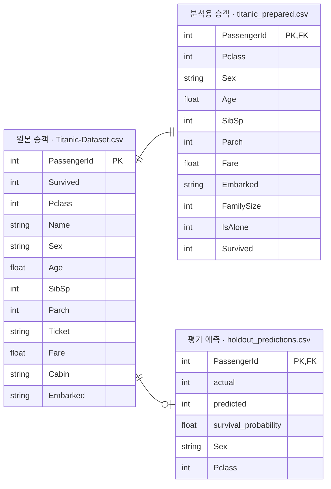

# 타이타닉 데이터 분석·생존 예측 대시보드

Kaggle 공개 승객 표본을 수집·분석하고, 생존 예측 모델과 근거 검색 Q&A를 실습하는 Streamlit 학습용 앱입니다. Q&A는 저장소에 포함된 고정 사실표와 설명서의 원문을 보여 줍니다.

## 주요 기능

| 메뉴 | 구현 내용 |
|---|---|
| 프로젝트 안내 | 표본 규모·생존율·결측값·수집 이력 표시 |
| 데이터 분석 | 성별·객실 등급 필터, 성별·등급·항구별 생존율, 연령 분포, 결측값 표, 선택 표본 CSV 다운로드 |
| 생존 예측 실습 | 가상 승객의 조건으로 저장된 모델의 추정값과 분류 결과 확인 |
| 모델 평가 | 모델 비교, 정확도·재현율·ROC-AUC, 혼동 행렬과 하위 집단 평가 |
| 분석 Q&A | 고정 사실표·모델 설명·보도 검수 지침의 무료 검색과 선택적 AI 근거 선택 |

## 빠른 실행 — Windows 11 / PowerShell

저장된 평가 기록의 환경은 **Python 3.12.10**입니다. Python 3.12와 Git을 준비하고 작업할 상위 폴더에서 실행합니다. `.venv-local`은 기존 환경과 구분하기 위한 새 가상환경입니다.

```powershell
git clone -c core.autocrlf=true https://github.com/gamzpot96-cell/titanic_dashboard.git
cd titanic_dashboard
py -3.12 -m venv .venv-local
.\.venv-local\Scripts\python.exe -m pip install -r requirements.txt
.\.venv-local\Scripts\python.exe prepare_project.py --verify-facts
.\.venv-local\Scripts\python.exe -m streamlit run app.py
```

**클론 옵션의 이유:** 현재 수집 기록의 SHA-256은 CRLF 줄바꿈의 CSV를 기준으로 합니다. GitHub에 저장된 CSV는 LF여서 수치가 같아도 검증값이 달라집니다. 위의 저장소별 `core.autocrlf=true` 설정으로 체크아웃하면 기록된 원본 바이트를 복원할 수 있음을 확인했습니다. 전역 Git 설정은 바꾸지 않습니다.

`--verify-facts`는 PKL에서 사실표를 다시 계산해 저장본과 대조합니다. 앱은 저장된 모델을 사용합니다. 모델을 다시 학습할 때는 같은 폴더에서 `prepare_project.py`를 옵션 없이 실행합니다. 준비 스크립트는 고정 근거 검증을 통과한 뒤 분석용 복사본과 모델·평가 결과를 갱신합니다.

정상 검증 메시지는 `고정 사실표 검증 완료: 21개 근거가 저장본과 일치합니다.`입니다. 앱 실행 후 터미널의 `Local URL`로 접속합니다. 기본 주소는 **http://localhost:8501**이며 포트가 사용 중이면 표시된 실제 주소를 따릅니다. 종료는 터미널에서 `Ctrl+C`입니다.

## 데이터와 분석 범위

출처: [Titanic Dataset / Yasser H. — Kaggle](https://www.kaggle.com/datasets/yasserh/titanic-dataset)

- 수집 도구·고정 버전: `kagglehub.dataset_download("yasserh/titanic-dataset/versions/1")`.
- 원본 `data/Titanic-Dataset.csv`: **891행·12열**, 생존 342명·비생존 549명. 이는 정답이 있는 승객 표본이며 전체 탑승객·승무원 명단이 아닙니다.
- 수집 시각·출처·버전·SHA-256: [`data/collection_manifest.json`](data/collection_manifest.json).
- 분석용 복사본: `data/titanic_prepared.csv`. 이름·티켓·선실 번호를 제외하고 가족 관련 변수를 추가합니다.
- 연령 분석에서는 Age가 누락된 **177명**을 제외합니다. 표본 전체 생존율은 **38.38%**입니다.

데이터 분석 필터와 Q&A 사실표는 별개입니다. **화면에서 성별·등급을 바꿔도 Q&A는 저장된 사실표의 범위를 사용합니다.** 이 자료만으로 사고 원인·인물의 발언·역사적 사실을 검증하지 않습니다.

## 데이터 관계도 (ERD)

승객 단위 CSV 세 파일의 연결 관계입니다. `PassengerId`는 각 파일에서 행을 구분하는 고유 키(`PK`)입니다. 분석용과 평가용 파일에서는 원본 승객을 참조하는 키(`FK`)이기도 합니다. 관계선의 양쪽 기호는 상대 파일의 한 행에 연결되는 행 수를 나타냅니다.



| 연결 관계 | 원본 승객 1행당 | 연결된 파일의 1행당 | 확인 결과 |
|---|---|---|---|
| 원본 승객 ↔ 분석용 승객 | 분석용 **정확히 1행** | 원본 **정확히 1행** | 두 파일의 `PassengerId` 891개가 모두 일치합니다. |
| 원본 승객 ↔ 평가 예측 | 예측 **0행 또는 1행** | 원본 **정확히 1행** | 평가 승객 179명은 각 1행, 학습 승객 712명은 0행입니다. |

`||`는 정확히 1개, `o|`는 0개 또는 1개입니다. 세 파일에서 `PassengerId` 중복이 없어 이 ERD에 일대다(1:N)나 다대다(N:M) 관계는 없습니다.

분석용 승객 파일은 원본에서 이름·티켓·선실 번호를 빼고 `FamilySize`와 `IsAlone`을 추가한 복사본입니다. 평가 예측의 `actual`은 실제 정답이고 `predicted`는 모델의 분류 결과입니다. Q&A 사실표와 평가 지표는 표본 전체 또는 집단을 요약한 자료이므로 승객 단위 ERD와 별도로 봅니다.

## 생존 예측 모델

입력은 객실 등급, 기록된 성별, 나이, 동반 형제·배우자 수, 동반 부모·자녀 수, 기록된 승선 요금, 승선 항구입니다. `FamilySize=SibSp+Parch+1`, `IsAlone=(FamilySize==1)` 두 열을 추가해 총 9개 열을 전처리에 사용합니다.

1. 난수 42로 학습 **80% / 712명**, 평가 **20% / 179명**을 분리합니다.
2. 숫자 결측값은 학습 구간의 중앙값, 범주 결측값은 최빈값으로 채우고 표준화·원핫 인코딩을 적용합니다.
3. 로지스틱 회귀와 랜덤 포레스트를 **학습 데이터의 5분할 교차 검증 ROC-AUC**로 비교합니다. 전처리도 각 학습 구간에서 다시 학습합니다.
4. 선택한 모델을 남겨 둔 평가 데이터로 평가하고 저장합니다. 저장 모델은 학습용 80%로만 학습한 상태입니다.

아래 수치는 최초 저장된 [`model/metrics.json`](model/metrics.json)에서 가져온 기준 평가 결과입니다. 재학습 결과는 모델 평가 화면에서 확인할 수 있고, Q&A는 별도로 보존한 기준 평가 결과를 인용합니다.

| 지표 | 저장된 값 |
|---|---|
| 선택 모델 | `random_forest` |
| 정확도 | **79.33%** |
| 생존 재현율 | **57.97%** |
| ROC-AUC | **0.8449** |
| 기준 모델 정확도 | **61.45%** |

생존 추정값 **0.5 이상**을 생존으로 분류합니다. 출력값은 확률 보정을 하지 않은 모델 추정값이며 실제 개인의 생존 가능성이나 조건 변경의 인과 효과가 아닙니다. 가족이 학습·평가 양쪽에 나뉠 수 있고 작은 하위 집단의 지표는 불안정하므로 정확도 하나만으로 판단하지 않습니다.

## 분석 Q&A

### 고정 사실표 재현

| 근거 ID | 입력 파일 | 계산 내용 |
|---|---|---|
| `F01`~`F18` | [data/titanic_data.pkl](data/titanic_data.pkl) | 원본 CSV와 같은 승객 891행·12열에서 인원·생존율·결측값·연령·가족 통계 계산 |
| `F19`~`F21` | [rag/evidence_manifest.json](rag/evidence_manifest.json)의 `reference_evaluation` | 저장소에 기록된 기준 모델의 분할 인원과 평가 지표 |

`titanic_core/evidence.py`의 `create_evidence()`가 PKL의 SHA-256을 확인한 뒤 열 이름과 값 목록을 DataFrame으로 복원해 통계를 계산합니다. `verify_facts()`는 이 통계와 기준 평가 기록으로 재현한 21행을 [고정 사실표](rag/titanic_facts.csv)와 대조합니다. 검증은 읽기 전용입니다. Q&A는 저장된 사실표의 검증값을 확인해 읽기 때문에 모델을 다시 학습해도 인용하는 수치는 고정됩니다.

### 검색 자료와 표시 방식

| 자료 | 구성 | 질문 예시 |
|---|---|---|
| A | 사실표 21개, `F01`~`F21` | 여성 승객의 생존율은 얼마인가요? |
| B | A + 모델 설명서, `M01`~`M06` | 모델은 어떤 입력을 사용하나요? |
| C | B + 보도 검수 지침, `R01`~`R04` | 기사에서 이 표본의 결과를 전체 탑승객의 통계로 써도 되나요? |

검색은 문자 2~4개 조각을 비교하는 scikit-learn TF-IDF 방식으로, 유사한 근거를 최대 4개 찾습니다. 별도 벡터 DB 서버나 검색용 임베딩 API는 사용하지 않습니다. 검색 표현에 따라 필요한 근거를 놓칠 수 있습니다.

| 근거 확인 방식 | 동작과 비용 |
|---|---|
| **근거 검색 (무료)** | 검색된 원문과 근거 ID·계산 기준 표시. API 키·추가 AI 패키지 불필요 |
| **AI 근거 선택 (API 비용 발생)** | 로컬에서 검색한 근거와 질문을 OpenAI에 보내 근거 ID를 최대 3개 선택. 앱이 해당 ID의 저장된 원문을 표시 |

관련 근거가 검색되면 AI 모드는 질문과 후보 근거로 API를 한 번 호출합니다. 응답이 올바른 ID 목록일 때만 해당 근거 원문을 표시합니다. 잘못된 형식이나 후보 밖의 ID가 오면 검색 근거를 직접 확인하도록 안내합니다. 예를 들어 여성 생존율은 저장된 `F03`의 **74.20% (233명 / 314명)**로 표시됩니다.

### AI 근거 선택을 사용할 때 추가 설치

프로젝트 폴더의 PowerShell에서 실행합니다.

```powershell
.\.venv-local\Scripts\python.exe -m pip install -r requirements-rag.txt
```

앱의 AI 근거 선택 모드에 본인 OpenAI API 키와 사용 가능한 모델 ID를 입력합니다. `OPENAI_API_KEY`, `OPENAI_MODEL` 환경변수가 있으면 입력란의 초기값으로 사용합니다.

근거 선택은 `titanic_core/evidence.py`의 Chat Completions 호출에서 수행하고, 생존 예측은 저장된 scikit-learn 모델에서 수행합니다.

API 키는 코드·Git 커밋·공유 화면에 포함하지 마세요. C의 보도 검수 지침은 이 프로젝트에서 작성한 자료이며 역사적 사건의 공식 규정집이 아닙니다.

## 코드와 결과물

| 경로 | 역할 |
|---|---|
| `app.py` | 시작점과 5개 페이지 연결 |
| `prepare_project.py` | 고정 사실표 검증, 선택적으로 분석용 복사본 생성과 모델 재학습 |
| `views/` | 프로젝트 안내·데이터 분석·생존 예측·모델 평가·Q&A |
| `titanic_core/config.py` | 경로·데이터 출처·입력 열·난수 설정 |
| `titanic_core/data.py` | 수집·검증·파생 변수·집단별 통계 |
| `titanic_core/modeling.py` | 전처리·학습·평가·저장·추론 |
| `titanic_core/evidence.py` | PKL 기반 사실표 재계산, 저장본 검증, 검색과 AI 근거 선택 |
| `data/` | 원본·분석용 CSV, 고정 데이터 PKL, 수집 기록 |
| `model/` | 모델 pkl, 지표 JSON, 분류 보고서, 평가 표본 예측, 집단별 지표 |
| `rag/` | 고정 사실표, 검증값과 기준 평가 기록, 모델 설명서와 보도 검수 지침 |

현재 저장소는 로컬 앱 구성입니다. Colab 학습·Gradio 시연·배포용 ZIP 생성 노트북은 이 저장소에 포함되어 있지 않습니다.

## 오류 확인과 검증 범위

| 상황 | 확인할 내용 |
|---|---|
| 원본 SHA-256 검증값 불일치 | 줄바꿈 변경이나 실제 파일 수정 여부 확인. 기존 원본을 보관하고 위의 클론 설정으로 새 폴더에서 다시 내려받기. 기록된 검증값을 임의로 고치지 않기 |
| 원본은 있는데 수집 기록이 없음 | `data/collection_manifest.json`을 함께 내려받았는지 확인 |
| 모델 버전·학습 데이터 불일치 | 올바른 원본을 준비한 뒤 현재 가상환경에서 `prepare_project.py` 재실행 |
| 사실표 또는 PKL 검증값 불일치 | 저장소의 기준 파일을 확인한 뒤 `prepare_project.py --verify-facts`로 재검증 |
| `No module named 'openai'` | AI 근거 선택을 사용할 환경에 `requirements-rag.txt` 설치 |
| AI 요청 실패 | 본인 API 키·모델 ID·권한·요금 한도 확인. 무료 근거 검색으로 나누어 확인 |

고정 버전의 의존성으로 사실표 21개를 재계산하고 모델 재학습 전후의 사실표 파일이 동일함을 확인했습니다. Streamlit 테스트에서 무료 검색과 모의 OpenAI 응답을 사용한 근거 선택을 확인했습니다.

## 출처와 이용 조건

- 데이터 출처: [Kaggle Titanic Dataset](https://www.kaggle.com/datasets/yasserh/titanic-dataset). 수집 기록에는 **CC0: Public Domain**으로 기록되어 있습니다. 이 기록과 별개로 배포·재사용 시 원본 페이지의 최신 이용 조건을 확인하세요.
- 코드·설명 초안 작성에 AI를 활용했습니다. 기사에 옮길 때는 표본 범위·계산식·인용 근거와 제출 기관의 AI 표시 기준을 사람이 확인합니다.
- 이름·티켓·선실 번호는 기본 분석 표시·다운로드·모델 입력에서 제외합니다. 원본 CSV에는 해당 기록이 있으므로 원본 자체를 공유할 때는 별도로 검토합니다.
- 이 저장소에는 별도의 코드 `LICENSE` 파일이 없습니다. 데이터 이용 조건과 코드 이용 조건은 구분해야 합니다.

관련 프로젝트: [Olist 대시보드](https://github.com/gamzpot96-cell/olist_dashboard)

